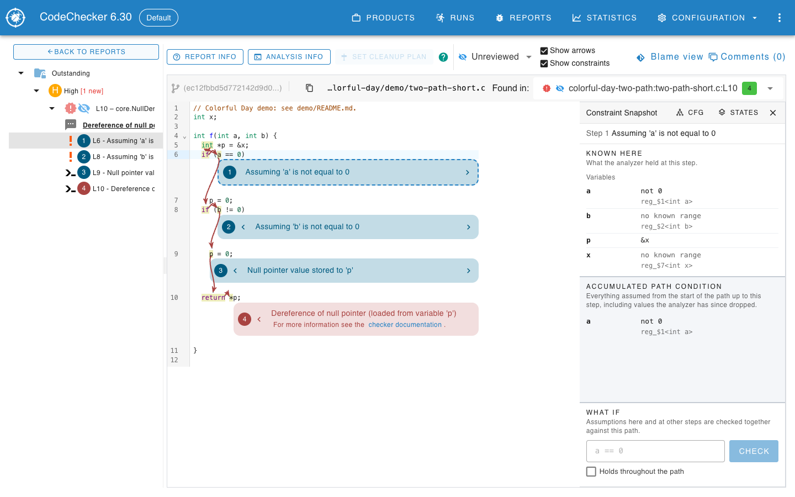
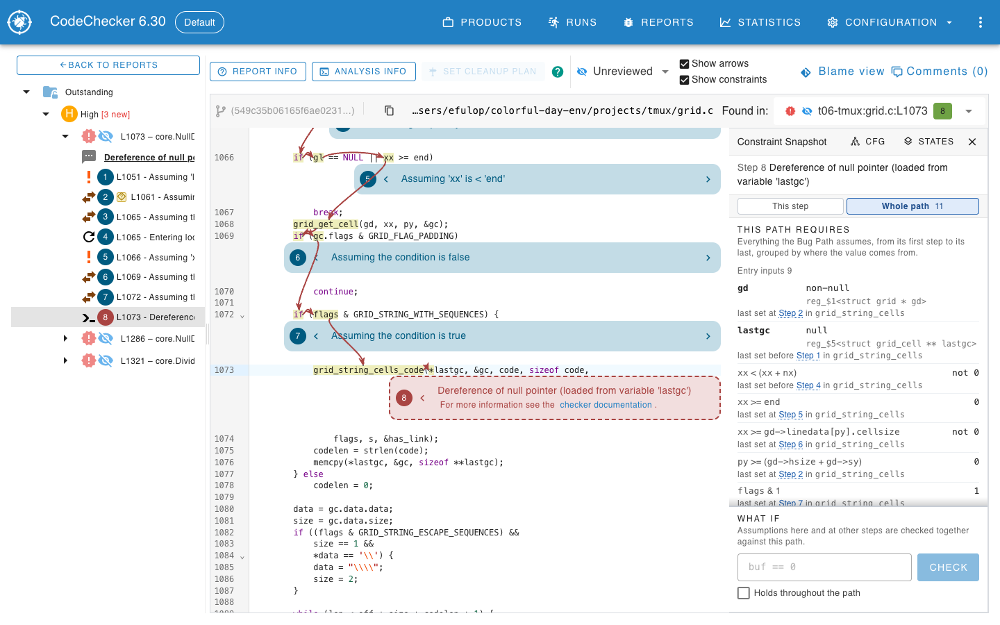
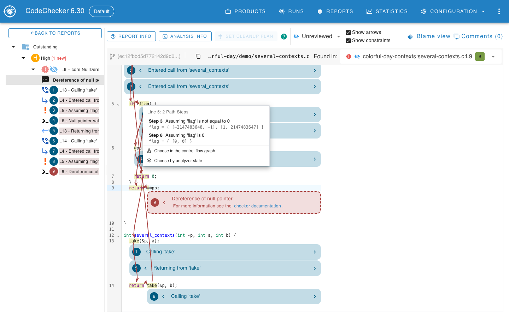
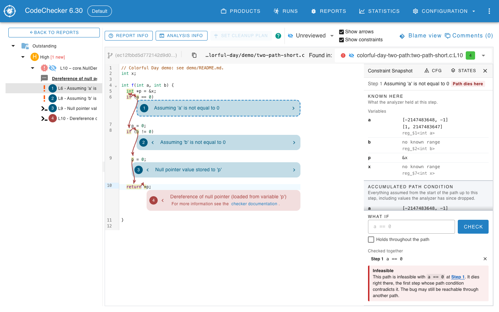
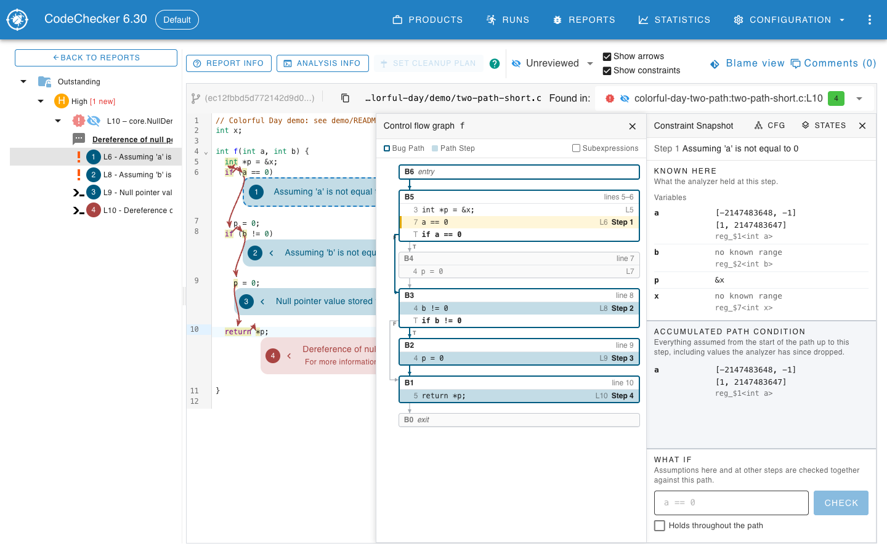
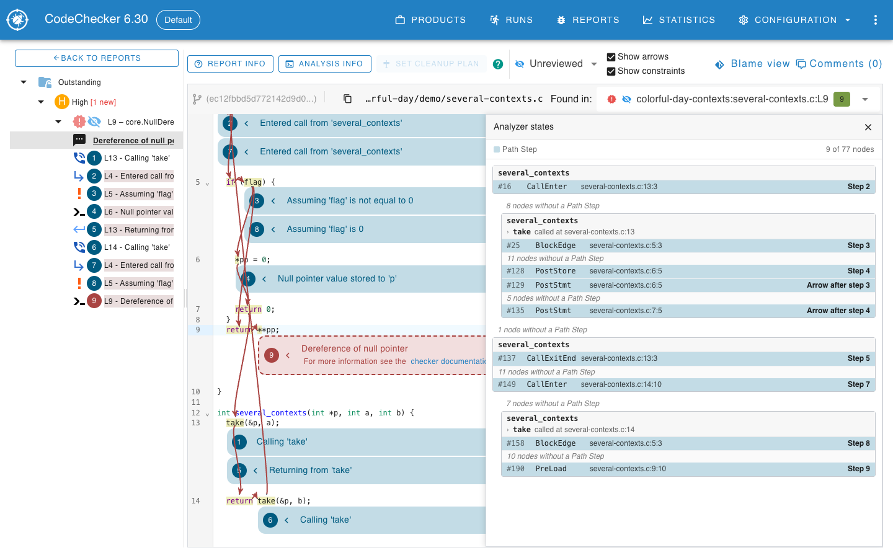

# Constraints of a bug path

The report page can show what the Clang Static Analyzer knew at each step of a bug path.
It can also check, with the Z3 solver on the server, whether the path stays feasible under assumptions of your own.
This is an experimental feature.
It needs data that Clang records only when asked to, and its format may change between releases.



## Table of contents
* [Recording the constraints](#recording-the-constraints)
* [Storing the reports](#storing-the-reports)
* [Show constraints](#show-constraints)
* [Reading the Constraint Snapshot panel](#reading-the-constraint-snapshot-panel)
  * [This path requires](#this-path-requires)
* [Selecting a step](#selecting-a-step)
* [What if](#what-if)
  * [Syntax](#syntax)
  * [Verdicts](#verdicts)
  * [Limits](#limits)
* [Control flow graph and analyzer states](#control-flow-graph-and-analyzer-states)
* [Server requirements](#server-requirements)

## Recording the constraints

Clang records the constraints when the analyzer option `emit-constraint-snapshots` is true.
It is off by default, and without it the report page looks as it always did.
Pass it to the Clang Static Analyzer through the `--analyzer-config` option of `CodeChecker analyze`:

```sh
CodeChecker analyze compile_commands.json -o ./reports \
  --analyzers clangsa \
  --analyzer-config clangsa:emit-constraint-snapshots=true
```

CodeChecker has no flag of its own for this.
The analyzer stores the data in the plist files in `./reports`, and `CodeChecker analyze` keeps it when it rewrites them.
The Clang documentation page "Constraint Snapshots in Plist Output"
(`clang/docs/analyzer/developer-docs/ConstraintSnapshots.md`) describes what is recorded and what it costs.
The plist files grow, and the analysis takes longer, so enable the option for the runs whose reports you want to explore this way.

The option exists only in a Clang that has this feature.
Whether a stored report has the data is visible in the report page, see [Show constraints](#show-constraints).

The What-If checks need the solver input (SMT-LIB) of the path, which Clang records only when it is built with Z3.
Without Z3 the report page still shows the ranges, but every What-If check answers "No verdict".

## Storing the reports

Store the reports as usual:

```sh
CodeChecker store ./reports -n my_run --url http://localhost:8001/Default
```

The constraint data is stored with the bug path of each report.
Only reports stored after they were analyzed with the option have it.
Storing again a report directory made without the option does not add it.
The data was recorded in a format version, and the server reads only the current one.
A report stored from an older Clang build of this feature has to be analyzed and stored again.

## Show constraints

The report page has a **Show constraints** checkbox below **Show arrows**.
It is off when the page opens.

The checkbox is disabled when the report has nothing to show.
Hover over it to see why:

| Tooltip | Meaning |
| --- | --- |
| Show constraints: click a bug path step or a source line to see what the analyzer knew there. | The checkbox is available. |
| This report has no constraint data. Analyze with the analyzer config option emit-constraint-snapshots=true to see what the analyzer knew at each step. | The report was analyzed without the option. |
| This report's constraint data was recorded in an older format, which this CodeChecker cannot show. Analyze and store the report again to see what the analyzer knew at each step. | The data is in a format version other than the one this server reads. |

With the checkbox ticked, the source lines that carry a bug path step are marked, and the path steps in the code and in the report tree can be selected.

## Reading the Constraint Snapshot panel

Selecting a step opens the **Constraint Snapshot** panel beside the source code.
Its title line gives the step, such as `Step 1 Assuming 'a' is not equal to 0`.
The panel can be closed with the cross in its header.
Two buttons under the title line choose what the panel shows: **This step**, described next, and **Whole path**, which is [This path requires](#this-path-requires).

**Known here** is what the analyzer held at that step:

* **Variables** lists the variables the analyzer tracks at that point, sorted by name.
  A variable that holds a symbol shows the range of values the analyzer knows for it, and under it the symbol's label, or the symbol itself, such as `reg_$1<int a>`, when the label would only repeat the variable's name.
  A symbol the analyzer no longer tracks at that step shows the last range the accumulated path condition has for it, with a **dropped** tag, as its row there has.
  A symbol that was never constrained reads "no known range".
  A variable that holds a concrete value shows the value, such as `&x`.
* Inside a call the analyzer followed, **Variables** has one group per function on the call stack.
  The function of the selected step comes first, headed by its name and the line it was called at, and each function that called it follows, innermost first, so that `n` of the caller and `n` of the callee are two rows under two headings.
  The line in a heading is a link that selects the step nearest to that call.
  A caller's group can be closed and opened with the arrow beside its name; with more than three callers they start closed, and a closed group says how many variables it has.
  A caller shows a local variable only while the analyzer still keeps it, which is while the caller reads it after the call; the parameters of the function the analysis started in keep the values it was called with.
  A global shows only under the innermost function that uses it, since it is the same memory in every function.
  A step in the function the analysis started in has no callers, and the list looks as it did before callers were shown.
* A pointer symbol whose range is exactly zero reads **null**, and one whose range is everything except zero reads **non-null**.
  Whether a symbol is a pointer comes from the type Clang records for it, so a pointer that is a field of a replaced value reads this way too.
  Hovering over the word shows the analyzer's own range.
* **Other symbols** lists symbols the analyzer has a range for that no listed variable of any function holds, for example the value of an expression.

**Accumulated path condition** is everything the analyzer assumed from the start of the path up to that step, as a range for each symbol.
It only narrows along a path.
A symbol the analyzer no longer tracks at the selected step is still listed there, with a **dropped** tag.
Rows are named by the variable that holds the symbol at the selected step, one of the step's own function first and of the innermost caller otherwise, and else by a variable that held it at an earlier step.
A variable names one value, the last it was seen to hold, so two rows share a name only when two calls of one function, such as a recursive one, each hold one.
A value whose variable was assigned another one since, or that a variable only held as a copy, as `SubNumElts` held the result in `unsigned SubNumElts = NumElts;` before `SubNumElts = NumElts / 2;`, goes by an earlier variable that still names it, here `NumElts`, or by its label alone.
The value a variable started with goes by that variable rather than by one that holds a copy of it, such as `SrcTy` rather than a callee's `Val`.
A name from another function is written `function::name`, as a debugger writes it, when a variable of that name in another function holds something else at that step, or two rows would otherwise read the same name, such as `top::n` inside a function whose own `n` is 7.
The function is written without `(anonymous namespace)::`, as in the heading of its group, and **What if** reads the same spelling.

A symbol reads as what it stands for, wherever the panel would show the symbol: under a variable, in **Other symbols** and in the accumulated path condition.

- The value memory held before the path changed it reads as the expression for that memory, such as `grid->rows`, `*q`, `line->cells[0].width` or `this->Current`.
  Memory the analyzer reads as another type than its pointer's reads through a cast, such as `((struct imsg *)data)->hdr`.
  The name comes from what Clang knows about the memory, so memory it cannot describe, such as a field of a call's result, keeps the analyzer's symbol.
  Memory of a call the function made, such as the `this` of an inlined method whose object the analyzer lost track of, keeps the analyzer's symbol too: `this` or a parameter's name would read as the function's own, and two calls' would read as one value.
- The size of memory the analyzer does not know reads as, for example, "size of `*gd->linedata`".

A symbol the analyzer made up reads as where it came from:

- The result of a call reads as that result, such as "result of `read_len()`, line 8".
  The analyzer evaluated that call without seeing inside it.
- Memory such a call may have changed reads as the memory and the call, such as "`Tok.Kind` after `lex(&Tok)` may have changed it, line 11" or "`this->Current` after `this->parse(…)` may have changed it".
  A call can change every global, so a global after it reads, for example, "`g` after `refresh()` may have changed it", and the value of all globals "a global after `refresh()` may have changed it".
- Memory a loop may have changed reads, for example, "`hits` after the loop may have changed it, line 6", with the loop's line.
  The analyzer made it when it stopped following the loop after a few passes, which it does only when analyzing with `-analyzer-config widen-loops=true`.
- A field of a call's result reads, for example, "`r.len` of the result of `get()`".
- A field of memory that has no name, such as a temporary or what a call's result points to, keeps the end of its access path, such as "`.Block` of a value after `Point(B)` may have changed it" or "`->next` of the result of `head()`".
- A construction the source does not spell, such as converting an argument to a class, reads as the class and its arguments, such as `Point(B)`, not as the argument alone.
- Any other symbol reads as the statement it was made for, such as "value from `malloc(16)`, line 11", because the analyzer did not record what kind of value it is, for example when a checker models the call.
  A symbol without such a statement reads "origin not recorded".

A symbolic expression reads from the labels of the symbols in it, such as "result of `size()` + 1" or "`hits` after the loop may have changed it > `n`".
A variable that held a symbol names it in the expression, and otherwise the symbol's own name or label does, such as `gd->linedata[py].cellsize`.
An expression with a part that cannot be named, or one this page cannot read to the end, is shown as the analyzer prints it, never half-way.
Hovering over it shows the analyzer's own expression.
Clang records the type of each expression a range is about, so its range reads in words too, such as "not 0" for `flags & 4`.

Two results of the same call text are marked.
The analyzer makes a new value for each call and does not assume that two calls return the same one, which matters when the second call looked certain to agree with the first, as in `if (x.size() > 0) ... x.size()`.
Each of two symbols on the bug path whose origin is a call with the same text carries a small tag beside its label, such as "another `size()` result, Step 4", and the step is a link that selects it.
The tooltip says that the analyzer does not assume the two calls return the same value.
With more than two, the tag names the nearest other one, adds how many more there are, and the tooltip lists every step.
A statement that Clang had to cut is not compared.

Values whose labels read exactly the same, from the same place in the same function, such as the results of one call inside a loop or in a function called several times, are counted instead, such as "result of `__min_element()`, min_element.h:47, 2nd of 5".
The count is the order in which the analyzer made them, and the tooltip says that it does not assume they are equal.
The tag of other results of the same call text then leaves these out.

The same labels show wherever a view names a symbol.
The line picker shows each variable that differs between visits of a line as a range in words, and its tooltip adds the label of the value.
When the variables of the line's own function are the same in two visits, the picker adds the callers' variables that differ, as `function::name`.
The control flow graph and the analyzer states views show statements and states, not symbols, so they have none to label; the panel they open shows the labels.
Rows of the panel are told apart by their symbol, never by their label or name, so two symbols with the same label are two rows.

Statement text longer than 40 characters is shortened the same way everywhere.
A call keeps what it calls and drops its arguments, such as "`this->parse(…)`", and falls back to the function's name when that is still long, such as "`lookup(…)`".
Anything else is cut at 40 characters.
The whole text is in the tooltip.
When the value was made in another function than the one of the selected step, the function follows, such as "in `next_len`".
Hovering over the label explains it and shows the call in full and the analyzer's own symbol, and clicking the line selects the step nearest to that statement or loop.
Reports analyzed before Clang recorded this show the symbols as before.

The rows that changed at the selected step are highlighted, in **Known here** and in the accumulated path condition.
A row has a coloured bar on its left and a tag beside its range: **new** for a symbol that had no entry at the step before, and **narrowed** for one whose range is narrower than at the step before.
The step before is the closest earlier step that shows a different snapshot, so the edge into a statement and the event on it show the same changes.
Nothing is highlighted at the first step, which has no step before it.

A step where the analyzer assumed something that the bug path has no event for is marked.
It is a control flow step that adds to the path condition, with no event on its analyzer state, such as a branch the analyzer took without an event saying so.
In the report tree the event next to it has a small question mark before its text.
In the source its line has an amber bar on the left and an **assumes** tag at its end.
The tooltip of both says that the analyzer assumed something here that the bug path does not describe, and the panel of that step says **Assumed, no event**.

An integer range reads the way a person would say it, in the snapshot, the path condition and the line picker:

* A range that excludes exactly one value reads "not N", so `[-2147483648, -1] [1, 2147483647]` of an `int` reads "not 0".
* A range of one value reads as the value, so `[1, 1]` reads "1".
* A range that runs from a value to the largest value of the type reads "at least N", and one that runs from the smallest value of the type to a value reads "at most N".
* A comparison, such as `xx >= end`, reads "false" when its range is `[0, 0]` and "true" when its range leaves 0 out, rather than as the number the analyzer keeps for it.
  Only a comparison at the top of the expression counts, so `(a < 5) + b` reads as a number.

The bounds of the type come from the type Clang records for the symbol, which is the canonical type, so a `size_t` is an `unsigned long` and a field of a replaced value has its own type.
For a trace without it, the type at the start of the symbol is read instead, such as `int` in `reg_$1<int a>`.
When the width or signedness of the type cannot be told for certain, as with an enum, a plain `char` or a `long` whose range stops short of the 64-bit extreme, the range is printed as the analyzer prints it, as a list of closed intervals.
Any other range is printed that way too.
Hovering over a range that is shown in words shows the analyzer's own range.

### This path requires

**Whole path** lists everything the bug path assumes, from its first step to its last, so that you can ask which of it is unrealistic and go to the code that assumed it.
It does not change with the selected step, and it has the same rows as the accumulated path condition of the last step, which is why the two are never on screen together.
The list reads the trace's symbol table to group the rows, entry inputs first:

* **Entry inputs** are what the function was called with: its parameters, globals and the fields of `this`, and what they point to, such as `SuperLoc` or `n`.
  A compound value made only of entry inputs, such as `m + n`, is listed here too.
* **Call results** are values that calls the analyzer did not see inside returned.
* **Replaced values** are memory that a call or a loop may have changed, and the parts of it.
* **Other** is everything else: a value whose origin the analyzer did not say, memory behind a call's result, memory of a call the function made, and an expression that mixes origins.

A group with no rows is left out, and a report whose trace has no symbol table shows one list with no groups.
A row is named and labelled as in the accumulated path condition, and has the **dropped** tag when the analyzer no longer knows the symbol's range at the last step.
Under it, a line says where the analyzer last assumed it: "last set at" and a link to the step that shows the row as it is at the end, then the function of that step.
Clicking the link selects the step, which shows its code.
Some assumptions have a node of their own, between two steps; the line then says "last set before" the first step that shows it, so the code to read is just ahead of that step.
When the step is an assumption the bug path has no event for, the line says "assumed with no event at" and the link is to that control step.
A path with no constraints shows "This path has no constraints on it."

#### An example

**Show an example** above the rows asks the server for one example of the path: one value for each row, which together follow the bug path.
The value appears beside the row's range, after "e.g.", or under it when the panel is narrow.
It is the value Z3 gives the row's expression in one model of the path's solver input, so `m + n` shows the solver's value of the sum, which may have wrapped around.
A row such as `m + n` has a value, but `m` and `n` get none of their own unless the path constrains them on a row of their own, since any value of a symbol the path does not constrain would do.

* A number is in the signedness of the analyzer's range for the row, so an `int` shows `-1` where an `unsigned int` would show `4294967295`.
* A pointer reads **null** or **non-null**, since its number means nothing.
* A comparison reads **true** or **false**.
* An enum or a `bool` reads as its number.

The example is one of many, and the panel says so.
It is a model of what the analyzer recorded, not proof that a real execution can follow the path, for the same reasons that a Feasible verdict is not.
It respects the constraints in the **Checked together** list of [What if](#what-if), whether they hold at one step or throughout, and it disappears when that list changes, since it no longer matches it.
**Hide** removes it.
It is made from the same solver call as the verdict, so it never changes the verdict, and it is never stored, not in the database and not in the browser.

There is no example when the path is not feasible with those constraints, when the solver gives up at its time limit, or when a constraint cannot be read; the panel then says why in place of the values.
A report without solver input offers no example and says "No example: this report has no solver input for this path. Recording it needs a Clang built with Z3."



## Selecting a step

With **Show constraints** ticked:

* Click a bug path step, in the code or in the report tree, to select it.
* Click a source line.
  If exactly one step is on the line, it is selected.
  If the line is not on the bug path, nothing changes and a short message says "Line N is not on this Bug Path, so the selection did not change."
  If several steps are on the line, a list titled "Line N: K Path Steps" opens.
  A line is visited more than once by a loop or by a function that is called from several places.
  Each entry of the list shows the step, and the values of the variables that differ between the entries, so that you can tell the visits apart.
  Steps that would show the same panel count as one entry.

A control flow step, which the bug path draws as an arrow between lines and has no event of its own, is named by the event before it: "Edge after Step 2", or "Edge before Step 1" when no event comes first.
Verdicts and links use that name.

At the foot of the list, **Choose in the control flow graph** and **Choose by analyzer state** select the step in the views described in [Control flow graph and analyzer states](#control-flow-graph-and-analyzer-states).



## What if

The panel ends with a **What if** section.
It lets you tell the server something you know that the analyzer does not, such as "this global is never null", and asks whether the reported path is still possible.
The server checks the path with Z3, using the solver input recorded for it.
No analysis is run again.



### Syntax

Type a constraint in the field and press **Check** or Enter.
The field suggests an example from the names of the step.
A constraint is one or more comparisons joined by `&&`:

```
a == 0
a == 0 && n > 3
p != null
```

* A comparison is `name op value`.
  The operators are `==`, `!=`, `<`, `<=`, `>` and `>=`.
* The name is one the panel shows at the step:
  * a variable of the step's function or of any function that called it, such as `n`, or written with its function, such as `top::n`;
  * memory the panel names, such as `grid->rows`, `*q`, `line->cells[0].width` or `this->Current`.

  A name is identifiers joined by `.` and `->`, after any `*`, with subscripts that are an integer or a name themselves, such as `Op.Node->ValueList[Op.ResNo].V.SimpleTy`, and a function before `::`.
  It is matched as text against the names of the step, not read as C, so `p->len` and `(*p).len` are not the same name.
  A variable hides memory of the same name.
* The value is an integer, or `null`, which is 0.
  There is no `||`, no arithmetic, and no comparison of two names.
* A variable is read as the value it holds at the step you typed the constraint at.
  Memory is read as the value the panel labels with its name: the value it held before the path changed it, reading `this->Current`, and the value a call or a loop left in it, reading "`this->Current` after `this->parse(…)` may have changed it".
  Comparisons on a signed type are signed, on an unsigned type unsigned.

ArrowDown opens a list of every name the check can decide at the step, with its value, and typing narrows it to the names that start with the text typed, or have a part after `::`, `->` or `.` that does.
Tab or Enter completes one.
A value that has a name of its own is listed once, under that name; a name that stands for several values is not listed, and the list offers each of them with its function, such as `middle::n` and `top::n` for `n`.
With **Holds throughout the path** ticked, the list has the names that work throughout, such as `this->Current` when the path has several values of it.
The list is the server's own: a test compares it with what the server resolves at every step of the test reports.

A text that cannot be read is not added.
The field turns red and a message such as "Expected an operator (`==`, `!=`, `<`, `<=`, `>`, `>=`), found `x`." says what was expected, with the cursor placed where reading failed.

**Holds throughout the path** applies the constraint to every value the name takes on the path, also after a call or an assignment replaces the value.
For memory that is every value the panel labels with its name, so `this->Current != null` throughout says that the field is never null, before and after any call that may have changed it.
Without it the constraint is about the value at the step it was typed at.

Every constraint you add stays in the **Checked together** list, labeled by its step or "Throughout", and all of them are checked together against the path.
A constraint can be removed with the cross at its row.
Pressing **Check** with an empty field checks the list again.
Constraints exist only in the open report page, and opening another report starts with none.

### Verdicts

Every verdict is about this reported bug path.
It does not say whether the bug is reachable through another path.

The result is one or two boxes:

* **Feasible**: "This path stays feasible with `a == 0` at Step 1."
  The path is still possible under your assumptions.
* **Infeasible**: "This path is infeasible with `a == 0` at Step 1.", followed by where the path dies and the sentence "The bug may still be reachable through another path."
  The step where the path dies is a link that selects it, and the step is tagged **Path dies here** in the panel.
  Where it dies is one of:
  * "It dies right there, the first step whose path condition contradicts it."
  * "It dies at Step N, the first step whose path condition contradicts it."
  * "It dies earlier, at Step N, whose path condition already contradicts it."
  * "It is dead by Step N. The solver gave up before it could tell whether an earlier step is dead too."
    The step is then tagged **Path dead here**, because an earlier step may be dead too.
* **Unknown**: "No verdict for this path with `a == 0` at Step 1.", followed by the reason.
  The constraint that caused it is marked in the **Checked together** list.

With several constraints, "this path stays feasible with these 2 assumptions together." names the count instead of one constraint.

The reason of an Unknown verdict is one of:

* "The solver gave up on this path after 2000 ms."
* "The solver has no answer for this path (...)" with the solver's own reason.
* "Cannot read the constraint: ..." for a syntax error.
* "`x` has no tracked value at this Path Step.", or "at any Path Step" with **Holds throughout the path**.
* "`n` names 2 values at this Path Step: `middle::n` and `top::n`. Write the one you mean."
  Variables of that name in several functions hold different values there, and writing the function picks one.
  With **Holds throughout the path** it reads "at one Path Step of this path", since a name has to stand for one variable wherever the path has it.
* "`this->Current` names 3 values at this Path Step: the one before the path changed it; the one after `this->parse(prec::LogicalOr)` may have changed it, line 3486; and the one after `this->parse(prec::Assignment)` may have changed it, line 3490. Holds throughout the path constrains all of them."
  Memory that calls replaced has several values by the step, and only **Holds throughout the path** can be about them.
* "N is outside the range of `x` (low to high)."
* "`x` holds ..., whose numeric value is not recorded, so only a comparison with 0 or null can be decided."
  This is the case of an address.
  An address is known to be non-null, and nothing else about it is recorded.
* "`x` holds ..., whose type the check cannot reason about."
* "This report has no Constraint Snapshots, so this path cannot be checked."
* "This report has no solver input for this path. Recording it needs a Clang built with Z3."
* "This report's Constraint Snapshots were recorded in an older format, so this path cannot be checked. Analyze and store it again to check it."
* "This report's Constraint Snapshots are unreadable, so this path cannot be checked."
* "The solver input recorded for this path is unreadable."

Each check also solves the path without your constraints, the baseline.
A baseline box appears only when the baseline is not Feasible, since then your assumptions are not what decides the verdict:

* "Without your assumption: Infeasible": "Z3 finds this path infeasible even with nothing added, although the analyzer's own solver accepted it. It is not your assumption that rules it out."
* "Without your assumption: Unknown": "There is no verdict for this path even with nothing added." and the reason.

### Limits

* The answer is about the one path of the report.
  An Infeasible verdict does not prove that the bug cannot happen.
* Constraints are never stored, not in the database and not in the browser.
  They cannot be shared or reviewed later.
* The solver gets 2000 ms for each call.
  A check makes up to two calls and then, if the path is infeasible, searches for the first step where it dies for up to 4000 ms more, so a check can hold a server worker for up to 8 seconds.
  Asking for an example adds no call.
* A name is what the panel shows, so a value the panel cannot name, such as a field of a temporary or the size of memory, cannot be constrained either.
* A function whose name has template arguments, or a lambda, cannot be written before `::`, so its variables can only be named alone.
  The list leaves such names out.
* Memory is told apart by its name only, so only the analyzed function's memory and globals are named: the `this` and parameters of a call it made have no name to write.
  When a function calls itself, its two frames have the same name, and the Unknown verdict says where each was called.
* The check reasons about what the analyzer recorded.
  Z3 and the analyzer's solver can disagree about nonlinear arithmetic or bit tricks.
  A variable it cannot reason about gives Unknown, not Feasible.

## Control flow graph and analyzer states

The header of the panel has two buttons, **CFG** and **States**, which show as icons below a 1280 pixel wide window.
Each opens a view next to the source code, and opening one closes the other.
Both mark the steps of the bug path, and selecting a step in them shows its panel.



The **Control flow graph** view shows the control flow graph of one function, chosen from a list when the path runs through several functions.
Its blocks are labeled B and the block number, with the lines they cover.
The edges and blocks the bug path took are outlined, and the rows that carry a path step are shaded and labeled with their step.
**Subexpressions** adds every element of the graph, as the `debug.DumpCFG` checker lists them.
Clicking a row with a step selects it, and a row with several steps opens the list described in [Selecting a step](#selecting-a-step).
Rows scrolled out of view are not in the page, so the search of the browser does not find them.



The **Analyzer states** view lists the analyzer's nodes (nodes of the exploded graph) that the path steps come from, grouped by call stack and indented by call depth.
Each row gives the node number, its kind, its location and the step it belongs to.
Between rows it counts the nodes that have no path step.
It tells apart steps on the same line that differ only by calling context, which the source and the control flow graph cannot.

## Server requirements

The What-If check uses the `z3-solver` Python package, which provides the `z3` module.
It is listed in `web/requirements.txt` and is installed with the other requirements of the server:

```sh
pip install -r web/requirements.txt
```

The server imports it when it starts, so it is needed even if nobody uses What-If.
